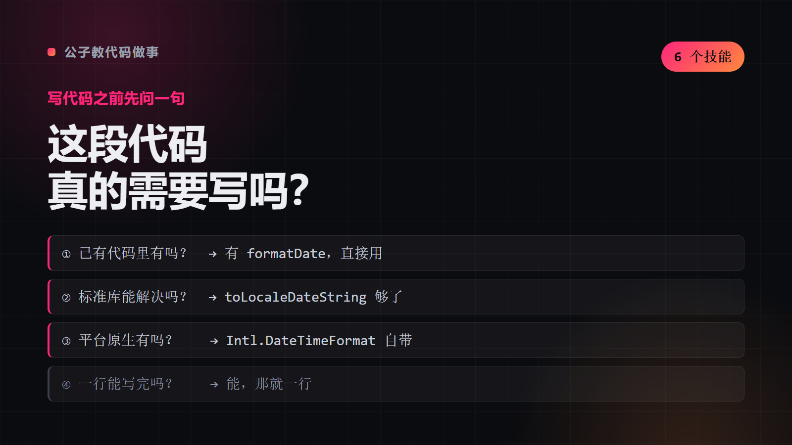
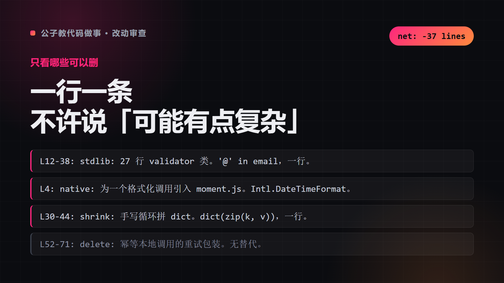
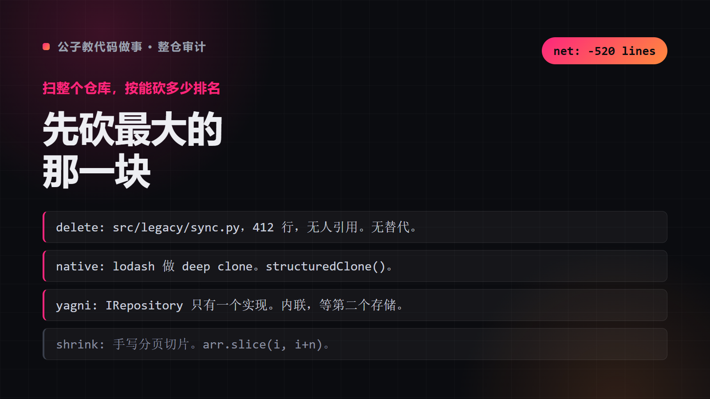
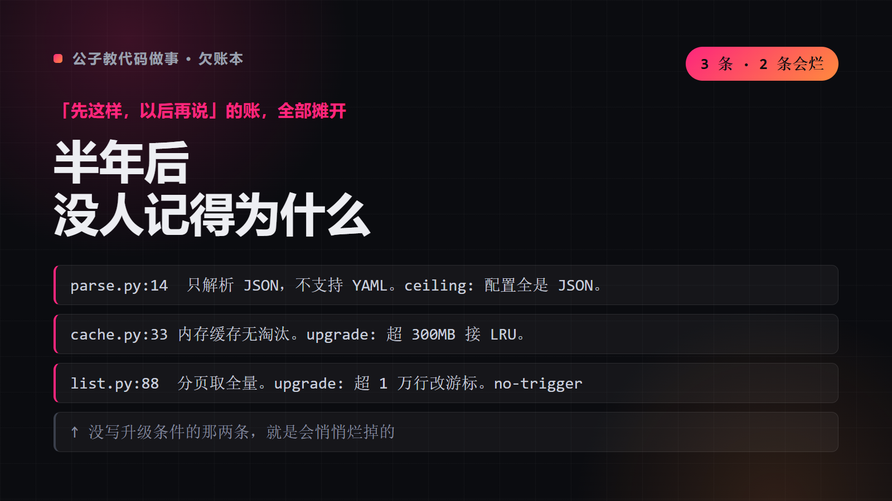
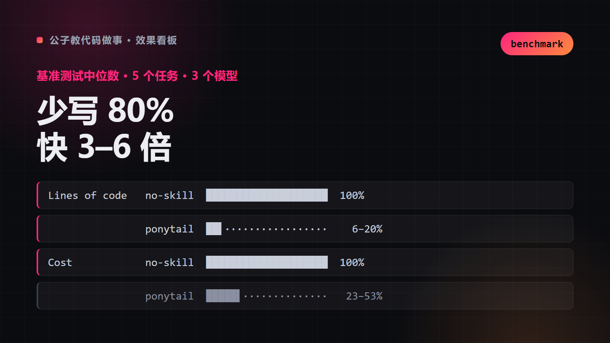
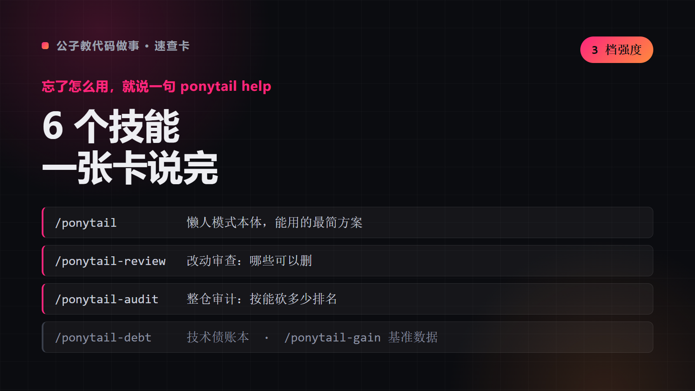

# 公子教代码做事

写代码之前先问一句：**这段代码真的需要写吗？**

不是让你少干活，是让你别写那些根本不该存在的代码。一个主技能 + 五个配套，从「动手前拦一下」到「事后查账」。

## 六个技能

<p>
  
  
  
</p>
<p>
  
  
  
</p>

| 技能 | 一句话 |
|---|---|
| **主技能** | 动手前拦一下，六步阶梯从「已有代码」问到「才动手写」 |
| **改动审查** | 只看这次 diff，一行一条，结尾给 `net: -N lines` |
| **整仓审计** | 扫整个仓库，按能砍多少从大到小排名 |
| **欠账本** | 把所有「以后再说」的注释收成一张表，标出会烂掉的那几条 |
| **效果看板** | 基准测试中位数：代码量、成本、速度 |
| **速查卡** | 忘了怎么用就说一句 |

## 📺 六步是怎么走的

```
你说：帮我加个工具函数，把日期格式化一下
     ↓
① 已有代码里有吗？        → 有 formatDate，直接用
② 标准库能解决吗？        → toLocaleDateString 够了
③ 平台原生有吗？          → Intl.DateTimeFormat 自带
④ 一行能写完吗？          → 能，那就一行
⑤ 都不行，才动手写        → 写，但只写必需的
⑥ 写完标注：简化了什么、上限在哪
```

> 六步走完，常常是「零行代码」或者「一行」。省下的不是打字时间，是以后维护的时间。

## What This Does

把「过度设计」这件事从根上掐掉。AI 写代码最大的毛病不是写错，是**写多**——多出来的抽象、多出来的依赖、多出来的配置，最后都变成维护成本。

### Key Features

- **六步阶梯**：已有代码 → 标准库 → 平台能力 → 一行解决 → 才动手
- **四档强度**：轻 / 标准 / 极致 / 关，按项目情况切
- **五个配套**：整仓审计、欠账本、改动审查、效果看板、速查卡
- **只读为主**：审计和审查只出报告，不动你的代码
- **会话级生效**：开启后一直有效，说「关」就退出

## 边界（必须知道）

| 适合 | 不适合 |
|---|---|
| 写代码、加功能、重构、修 bug | 知识问答、写文章、翻译、摘要 |
| 做评审、做设计、选依赖 | 需要大量样板代码的场景（如某些框架初始化） |
| Agent 容易过度设计的场合 | 已有代码风格强制要求冗余的团队 |

> 非编码任务不要开——它会让你连话都懒得说。

## Installation

### WorkBuddy / Claude Code

```bash
git clone https://github.com/chengangrun-ai/gongzi-teaches-code.git \
  ~/.workbuddy-ai/skills/gongzi-teaches-code
```

### 装哪几个

`skills/` 下是 6 个独立技能，按需拷贝：

```bash
# 只要主技能
cp -R skills/gongzi-teaches-code ~/.claude/skills/

# 全都要
cp -R skills/* ~/.claude/skills/
```

### 其他 Agent

把仓库链接丢给它，让它读 `skills/<名字>/SKILL.md`。

## Usage

### 主技能：动手前拦一下

```
公子教代码做事
```

四档强度：`轻` / `标准`（默认）/ `极致` / `关`。说「关」退出。

### 整仓审计

```
整仓审计
```
扫整个仓库，按「还能砍掉多少」从大到小列出可删可简的地方。**只出清单，不动代码。**

### 欠账本

```
欠了什么
```
把代码里所有「先这样、以后再说」的注释收成一张表，写清简化了什么、上限在哪、什么时候该还。

### 改动审查

```
审查这次改动
```
只看这次 diff，判断有没有多余抽象、重复代码、可以删的分支。

### 效果看板

```
省了多少
```
统计用之前之后代码量、依赖数、构建时间的变化。

### 速查卡

```
怎么用
```
全部档位、命令和切换方式一页看完。

## Architecture

| 目录 | 作用 | 何时加载 |
|---|---|---|
| `skills/gongzi-teaches-code/` | 主技能：六步阶梯 + 四档强度 | 每次写代码 |
| `skills/gongzi-teaches-code-audit/` | 整仓审计，只读 | 想清理项目时 |
| `skills/gongzi-teaches-code-debt/` | 欠账本，只读 | 想盘点技术债时 |
| `skills/gongzi-teaches-code-review/` | 单次改动审查，只读 | 提 PR 前 |
| `skills/gongzi-teaches-code-gain/` | 效果看板 | 想量化收益时 |
| `skills/gongzi-teaches-code-help/` | 速查卡 | 忘了怎么用时 |
| `LICENSE` | MIT（含原作者版权） | — |

## Philosophy

1. **最好的代码是没写的代码。** 不写就不会有 bug，不需要测试，不用维护。
2. **先找现成的。** 大部分「新需求」都是「已有能力换个说法」。
3. **抽象要等到第三次。** 两处相似就抽象，是过度设计的开始。
4. **简化要留痕。** 简化了什么、上限在哪，写在注释里，否则以后没人敢动。
5. **只读工具比改代码工具更安全。** 审计、审查、欠账本都不动你的代码。

## Requirements

- 支持 Agent Skills 格式的客户端（WorkBuddy / Claude Code / Cursor / Codex）
- 无运行时依赖，纯提示词

## Credits

基于 [Ponytail](https://github.com/DietrichGebert/ponytail)（MIT，作者 DietrichGebert，17.4 万 star）改写的中文版。
核心思路一致，表述、结构与配套技能按中文语境重写。原版权声明见 `LICENSE`。

中文版维护：[@chengangrun-ai](https://github.com/chengangrun-ai)

## License

MIT — Use it, modify it, share it.
